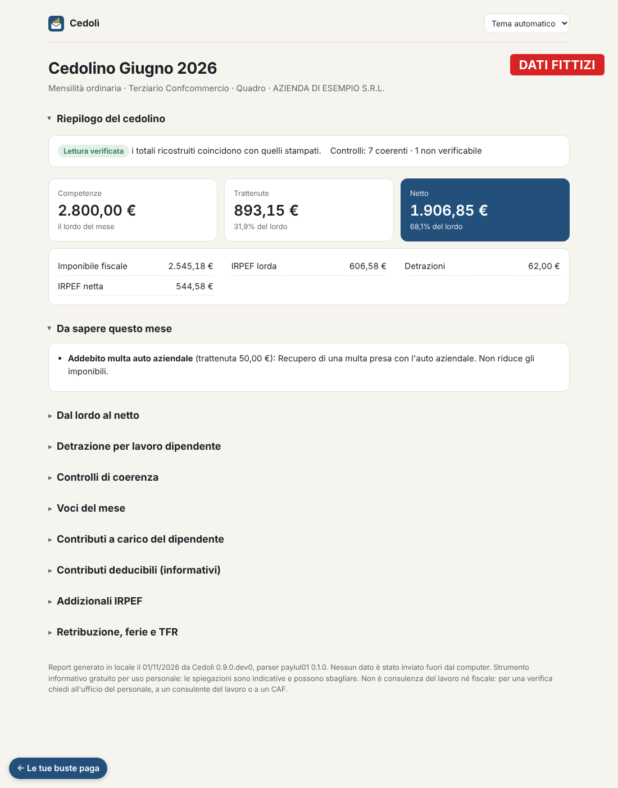

# Busta chiara

**La tua busta paga spiegata, interamente sul tuo computer.** Trascini il PDF del cedolino e Busta chiara ti mostra cosa vuol dire ogni voce, controlla che i conti tornino e tiene lo storico mese dopo mese. Nessun dato esce dal PC.

Gratuita per uso personale.

**[Scarica l'ultima versione per Windows](https://github.com/FabioCuccaro/busta-chiara/releases/latest)**

<a href='https://ko-fi.com/O3Z529TU5Z' target='_blank'></a>

<picture>
  <source media="(prefers-color-scheme: dark)" srcset="docs/img/app-mese-scuro.png">
  
</picture>

*Le immagini mostrano cedolini inventati.*

## Cosa fa

- **Spiega ogni voce** in parole semplici: retribuzione, contributi, IRPEF, detrazioni, addizionali, TFR, ferie e permessi.
- **Ricostruisce il passaggio dal lordo al netto** e controlla che i totali stampati tornino.
- **Segnala le cose da chiedere** all'ufficio del personale, per esempio una detrazione diversa da quella attesa.
- **Tiene lo storico**: netto e trattenute mese per mese, e cosa è cambiato rispetto al mese prima.
- **Salva lo storico in un file** da aprire anche senza l'app, da un altro computer o dal telefono.

## Privacy: nessun dato esce dal computer

Busta chiara non usa Internet. La pagina che vedi nel browser è servita dal tuo computer (`127.0.0.1`) e non è raggiungibile da altri. I cedolini restano in una cartella sul tuo PC: per cancellare tutto basta eliminarla.

Non serve fidarsi sulla parola: puoi usarla in modalità aereo, oppure bloccarla nel firewall di Windows, e funziona lo stesso. Le istruzioni passo passo sono in `LEGGIMI.txt` dentro lo zip. Il codice è qui per chi vuole controllarlo.

## Come si usa

**Windows**

1. Scarica `BustaChiara-windows.zip` dall'[ultima versione](https://github.com/FabioCuccaro/busta-chiara/releases/latest) ed estrailo.
2. Fai doppio clic su `BustaChiara.exe`. La prima volta Windows può mostrare "Windows ha protetto il PC": clicca *Ulteriori informazioni* e poi *Esegui comunque*. L'avviso compare perché il programma non è firmato da un editore registrato.
3. Si apre il browser: trascina i PDF dei cedolini.

**Linux e macOS** (serve [uv](https://docs.astral.sh/uv/))

```sh
uv tool install git+https://github.com/FabioCuccaro/busta-chiara.git
bp app
```

## Buste paga supportate

Oggi Busta chiara legge i cedolini "Libro unico del lavoro" prodotti da Zucchetti (modelli PAYLUL01 e HR1LULDIP), con i contratti del terziario e dei metalmeccanici.

Se la tua busta paga ha un altro formato, l'app te lo dice e ti mostra almeno competenze, trattenute e netto. Puoi aiutare ad aggiungerlo: l'app prepara una **struttura anonima** del PDF, senza importi né dati personali, che controlli e mandi tu, con una [segnalazione su GitHub](https://github.com/FabioCuccaro/busta-chiara-segnalazioni) oppure per email a bustachiara.segnalazioni@proton.me.

## Limiti

Le spiegazioni sono indicative e possono sbagliare. Busta chiara non è consulenza del lavoro né fiscale: fanno fede i numeri del cedolino. Per una verifica chiedi all'ufficio del personale, a un consulente del lavoro o a un CAF.

## Sostieni il progetto

Busta chiara è gratuita e la sviluppo nel tempo libero. Se ti è utile, puoi [offrirmi un caffè su Ko-fi](https://ko-fi.com/busta_chiara): mi aiuta ad aggiornare le regole fiscali ogni anno e ad aggiungere nuovi formati.

<a href='https://ko-fi.com/O3Z529TU5Z' target='_blank'></a>

## Licenza

Uso personale gratuito. Puoi passare lo zip ufficiale ad altri così com'è. Il codice è pubblicato per essere letto e verificato, non per essere riutilizzato. I dettagli sono in [LICENSE.md](LICENSE.md).

Per i dettagli tecnici (formati, controlli, struttura del codice, test) vedi [TECNICO.md](TECNICO.md). Le novità di ogni versione sono in [CHANGELOG.md](CHANGELOG.md).
