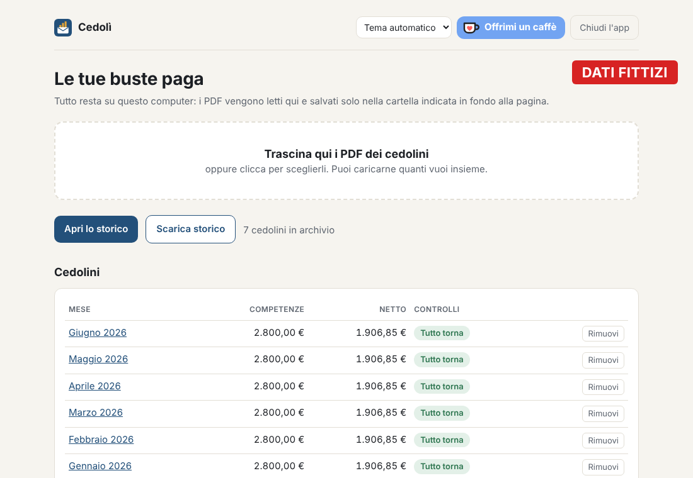
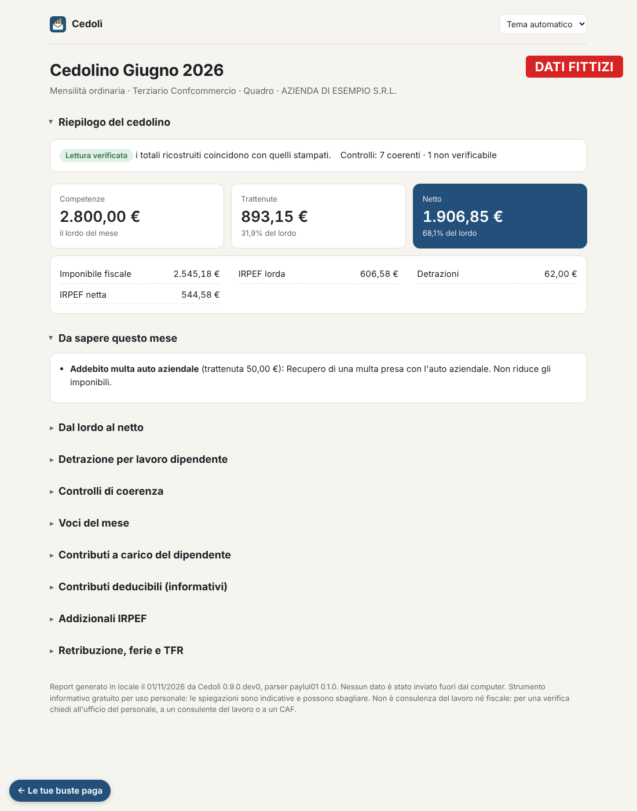
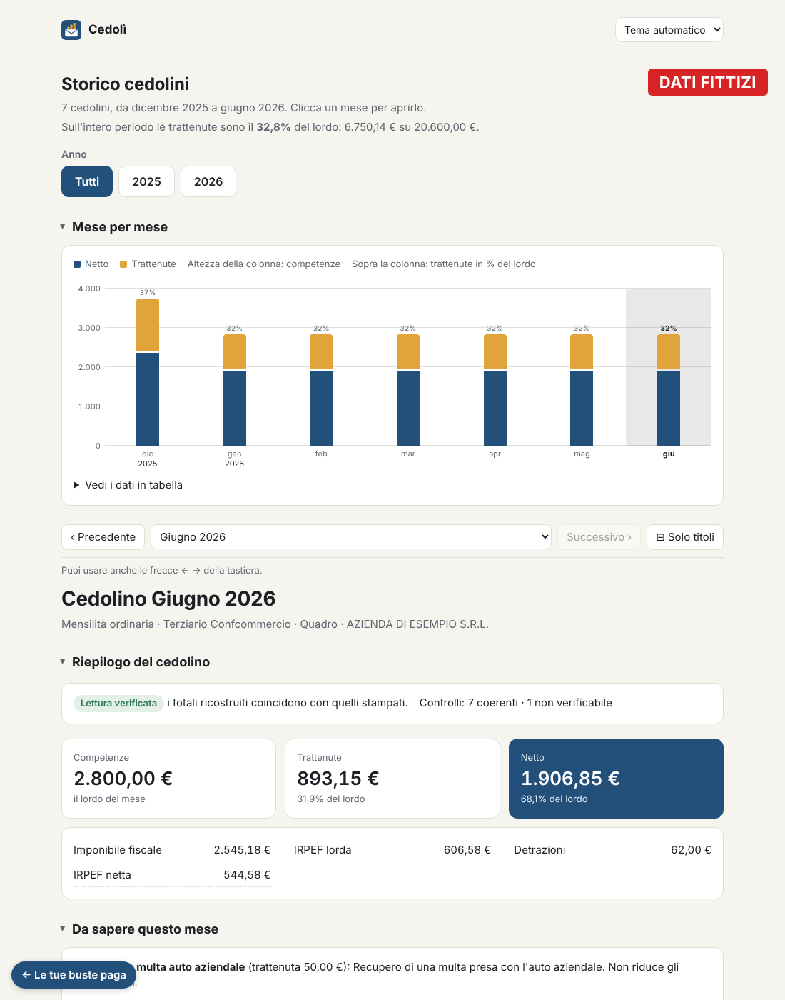

# Busta Chiara

Repository `busta_paga_beautify`, comando `bp`. Legge il PDF di una busta paga italiana **interamente in locale**, ne estrae voci e totali e verifica che i numeri letti ricostruiscano i totali stampati. Nessun dato esce dal computer.

Stato: estrazione con quadratura, spiegazione delle voci, controlli di coerenza, report HTML del singolo mese e storico navigabile con il confronto tra un mese e il precedente.

## Dove funziona

| Sistema | Come si installa | Come si avvia |
|---|---|---|
| **Windows** | nessuna installazione: zip con `BustaChiara.exe` ([dettagli](#windows)) | doppio clic su `BustaChiara.exe` |
| **Linux** (per esempio Omarchy) | `uv tool install` dal repository ([dettagli](#linux)) | `bp app`, oppure dal launcher delle app |
| **macOS** e sviluppo | `uv sync` in una copia del repository ([dettagli](#app-nel-browser)) | `uv run bp app` |

In tutti i casi si apre il browser su `http://127.0.0.1:8573/`, una pagina servita solo dal tuo computer, dove trascini i PDF dei cedolini.

## Come appare

> [!CAUTION]
> **Dati fittizi.** Gli screenshot mostrano cedolini inventati (generati da `tests/synthetic.py`, azienda "AZIENDA DI ESEMPIO S.R.L."): nomi e importi non corrispondono a persone o buste paga reali.

**Elenco dei cedolini.** Si trascinano i PDF nel riquadro; ogni cedolino mostra competenze, netto ed esito dei controlli.

<picture>
  <source media="(prefers-color-scheme: dark)" srcset="docs/img/app-elenco-scuro.png">
  
</picture>

**Report del mese.** Riepilogo, cose da sapere, passaggio dal lordo al netto, detrazione, controlli di coerenza e tutte le voci spiegate.

<picture>
  <source media="(prefers-color-scheme: dark)" srcset="docs/img/app-mese-scuro.png">
  
</picture>

**Storico.** Netto e trattenute mese per mese, e per ogni mese le voci che spiegano la differenza rispetto al precedente.

<picture>
  <source media="(prefers-color-scheme: dark)" srcset="docs/img/app-storico-scuro.png">
  
</picture>

**Aspetto.** Logo "busta e grafico" (una busta da cui escono tre barre), blu inchiostro e ocra su carta calda. Tutte le pagine hanno tema chiaro e scuro: seguono il sistema, oppure si sceglie *Tema chiaro* o *Tema scuro* dal menu in alto, e la scelta resta per le aperture successive. I colori sono variabili in `src/bp/report/templates/_stile.css`, il logo è in `_marchio.html` e in [`packaging/icona.svg`](packaging/icona.svg). Gli screenshot qui sopra seguono il tema chiaro o scuro di chi legge.

## Mese dopo mese

Lo storico non è un database da tenere aggiornato: a ogni apertura viene ricalcolato da tutti i PDF presenti nell'archivio.

1. **Arriva il cedolino nuovo**: lo trascini nell'app, che lo legge, verifica la quadratura e ne tiene una copia nella cartella dell'archivio.
2. **Elenco e storico si aggiornano da soli**: il mese nuovo entra nel grafico, nel riepilogo e nel confronto con il mese precedente.
3. **L'ordine non conta**: si possono caricare più mesi insieme o in ordine sparso; un file già caricato viene riconosciuto e ignorato; tredicesima, quattordicesima e cedolini aggiuntivi compaiono come voci a sé.
4. **Backup**: basta copiare la cartella dell'archivio. Se si perde, si ritrascinano i PDF e tutto si ricostruisce identico.

**Storico su un NAS o su un altro dispositivo.** Il pulsante *Scarica storico* salva `storico_cedolini.html`, un file autonomo che si apre in qualsiasi browser senza l'app e senza rete. È una fotografia dei cedolini caricati in quel momento: ogni mese, dopo aver caricato il cedolino nuovo, lo si scarica di nuovo e si sostituisce il file sul NAS. Da riga di comando: `bp storico <cartella archivio>/cedolini/*.pdf -o /percorso/nas/storico_cedolini.html`.

## Layout supportati

| Parser | Riconoscimento | Note |
|---|---|---|
| `paylul01` | metadato PDF `HRZ_MODEL=PAYLUL01`, oppure le intestazioni "LIBRO UNICO DEL LAVORO" / "VOCI RETRIBUTIVE" | mensilità ordinarie, tredicesima, conguaglio di fine anno, cedolini su più pagine, assunzione a metà mese con i redditi del datore precedente (voci "altri sostituti"). Verificato su 28 cedolini 09/2024-09/2026 |
| `hr1luldip` | metadato PDF `HRZ_MODEL=HR1LULDIP` (Zucchetti) | mensilità ordinarie, tredicesima e quattordicesima (cedolini "mensilità aggiuntive"), cedolini aggiuntivi per premi, conguaglio di fine anno e di cessazione, cedolini su più pagine. Verificato su 25 cedolini 2023-2024: tutti quadrano |

**Un formato nuovo, senza condividere il cedolino.** Quando l'app riconosce una busta paga ma non il suo formato, accanto al messaggio compare *Salva struttura anonima*: scarica `struttura_anonima.json` con la sola forma del PDF (posizione e font di ogni parola, intestazioni, codici delle voci, metadati del gestionale). Ogni cifra diventa 9 e ogni parola che non è nel [vocabolario delle buste paga](src/bp/knowledge/vocabolario.txt) diventa X: nomi, indirizzi, azienda, codice fiscale, IBAN, targhe. Il PDF non viene salvato. Chi lo riceve può scrivere il parser e un generatore sintetico del nuovo formato; chi lo manda lo apre e lo controlla prima. Da riga di comando: `bp anonimo cedolino.pdf -o struttura_anonima.json`.

**Mandare la struttura, sempre a mano.** Dopo il salvataggio l'app mostra il testo che il file contiene, riga per riga, così si controlla prima di mandarlo. Poi propone *Apri una segnalazione su GitHub* nel repository pubblico [busta-chiara-segnalazioni](https://github.com/FabioCuccaro/busta-chiara-segnalazioni), che contiene solo i modelli di segnalazione mentre il codice resta privato, e *Invia per email* a bustachiara.segnalazioni@proton.me, per chi preferisce non pubblicare il file (indirizzo in [`contribute.py`](src/bp/contribute.py)). Entrambi aprono solo un messaggio già scritto, nel browser o nel programma di posta: il file lo allega l'utente e nessun dato del cedolino finisce nel testo precompilato. L'app resta senza accesso a internet.

**Dalla struttura al parser.** Chi riceve una struttura anonima la passa a `bp struttura struttura_anonima.json`, che stampa un riepilogo del layout: gestionale e modello, pagine, font, dove stanno le etichette dei totali, se la lettura parziale funziona, la colonna dei codici delle voci, le colonne degli importi e le intestazioni. Con `--pdf` rigenera un PDF sintetico con le stesse parole nelle stesse posizioni, da usare come base per i test; parole molto vicine possono risultare unite. Con `--parser` scrive la bozza del modulo parser con riconoscimento e costanti già compilati. La lettura delle voci va poi scritta a mano. Il PDF sintetico richiede le dipendenze di sviluppo (`uv sync`).

**Pagina delle segnalazioni.** `uv run tools/segnalazioni.py` apre su `http://127.0.0.1:8574/` una pagina per chi mantiene l'app. Scarica gli allegati (`.json` o `.zip`) delle segnalazioni aperte del repository pubblico e li salva in `data/segnalazioni/github/`. Legge anche i file messi a mano in `data/segnalazioni/email/`, cioè quelli arrivati per email. Raggruppa le strutture per gestionale e modello, con il riepilogo di `bp struttura` e i link alle segnalazioni. *Prepara bozza* scrive in `data/formati/<formato>/` le strutture, il riepilogo, il PDF sintetico e la bozza del parser. Lo strumento usa la rete (l'API pubblica di GitHub; con `GITHUB_TOKEN` il limite di richieste sale), quindi sta in `tools/`, fuori dal pacchetto `bp`: l'app e l'eseguibile non lo contengono. `data/` non va mai nel repository.

**Lettura parziale.** Per una busta paga di un formato non supportato, o quando la lettura si interrompe, il messaggio riporta comunque i tre numeri principali se li trova: totale competenze, totale trattenute e netto. Li cerca dalle etichette che quasi ogni gestionale stampa ("TOTALE COMPETENZE", "TOT. TRATTENUTE", "NETTO DEL MESE", "NETTO IN BUSTA"...), con l'importo accanto o subito sotto, e dice se competenze meno trattenute fa il netto. Non legge le voci, non fa controlli e il cedolino non entra nell'archivio: i numeri vanno confrontati con il PDF. Provata sui 34 cedolini reali dei due formati supportati, come se fossero sconosciuti: trova i tre numeri giusti in tutti.

Differenze del layout `hr1luldip` che i controlli tengono in conto: ferie e permessi sono in ore; la quota dell'ente bilaterale a carico dell'azienda è stampata (riga C/Ditta); l'IRPEF del mese usa gli scaglioni annui divisi per 15 invece che per 12; l'imponibile previdenziale è arrotondato sul progressivo dell'anno, quindi nel mese può scostarsi di un euro.

Nel layout `paylul01` il trattamento integrativo (WZF051) e le sue restituzioni sono nella sezione imposta ma contano tra le competenze; nel 2024 la quota dell'ente bilaterale a carico dell'azienda non entrava nell'imponibile fiscale (dal 2025 sì).

## Uso

Richiede [uv](https://docs.astral.sh/uv/), tranne l'eseguibile per Windows.

### App nel browser

```sh
uv sync
uv run bp app
```

Si apre il browser su una pagina servita solo da questo computer (`127.0.0.1`): trascini i PDF, vedi l'elenco dei cedolini, il report di ogni mese e lo storico. I PDF caricati restano in una cartella personale (`%LOCALAPPDATA%\BustaChiaraBeautify` su Windows, `~/Library/Application Support/BustaChiaraBeautify` su macOS, `~/.local/share/BustaChiaraBeautify` su Linux; si cambia con `--cartella`). Un file che non si riesce a leggere non viene tenuto. L'app usa sempre l'indirizzo `http://127.0.0.1:8573/`, quindi si può salvare nei segnalibri; se è già aperta, un secondo avvio apre solo il browser (ma se quella aperta è una versione diversa, per esempio dopo un aggiornamento, la chiude e parte la nuova), e se la porta è occupata da un altro programma ne sceglie una libera. Il tasto *Chiudi l'app* spegne il programma (come chiudere la finestra del terminale o premere Ctrl+C).

**Quando un file non si legge.** Il file non viene tenuto e l'app dice perché, in parole semplici:

| Messaggio | Cosa fare |
|---|---|
| non è un PDF | caricare il PDF del cedolino, non una foto o un altro documento |
| il PDF è rovinato o incompleto | scaricarlo di nuovo (spesso è un download interrotto) |
| il PDF è protetto da password | aprirlo, salvarlo senza password e ricaricarlo |
| il PDF non contiene testo | è una scansione o una foto: serve il PDF originale dal portale |
| non sembra una busta paga | controllare di aver scelto il file giusto |
| sembra una busta paga, ma di un formato che Busta chiara non sa ancora leggere | il gestionale non è tra i [layout supportati](#layout-supportati) |
| formato riconosciuto, ma la lettura si è interrotta | un caso che il parser non prevede: va segnalato |

Un file illeggibile che si trova già nella cartella dell'archivio (per esempio copiato a mano) non blocca l'app: compare in fondo all'elenco, sotto *File che non si riescono a leggere*, e si può rimuovere. Se una pagina non si riesce a generare, l'app mostra un messaggio di errore invece di una pagina vuota.

### Windows

GitHub costruisce `BustaChiara.exe` a ogni modifica di `main` (workflow `windows`, in [`.github/workflows/windows.yml`](.github/workflows/windows.yml)) e lo prova su un cedolino sintetico:

- **ultima versione di `main`**: tab *Actions* → workflow *windows* → l'ultima esecuzione → artifact `BustaChiara-windows` (serve l'accesso al repository; resta disponibile 7 giorni);
- **versione da distribuire**: segui [Rilasciare una versione](#rilasciare-una-versione); lo zip compare tra le *Releases*.

Lo zip contiene `BustaChiara.exe` e [`LEGGIMI.txt`](packaging/LEGGIMI.txt), le istruzioni per i colleghi. Il doppio clic apre l'app come `bp app`; non servono installazione né permessi di amministratore. L'eseguibile non è firmato, quindi al primo avvio Windows mostra "Windows ha protetto il PC" (si supera con *Ulteriori informazioni* → *Esegui comunque*). Con argomenti si comporta come `bp` (`BustaChiara.exe report cedolino.pdf -o report.html`).

Per costruirlo in locale (anche su macOS o Linux, per provarlo):

```sh
uv sync --group build
cd packaging && uv run pyinstaller --noconfirm --distpath ../dist --workpath ../build BustaChiara.spec
```

### Linux

Si installa il comando `bp` una volta con uv e si lancia dal menu delle app:

```sh
# il repository è privato: gh fa accedere git via HTTPS con il tuo account
gh auth login && gh auth setup-git
uv tool install git+https://github.com/FabioCuccaro/busta_paga_beautify.git
bp app
uv tool upgrade busta-paga-beautify   # dopo ogni merge su main
```

Per averlo nel launcher, crea `~/.local/share/applications/busta-chiara.desktop`:

```ini
[Desktop Entry]
Name=Busta chiara
Exec=sh -c '"$HOME/.local/bin/bp" app'
Terminal=false
Type=Application
```

Si apre solo il browser; l'app si spegne con il tasto *Chiudi l'app* in alto nella pagina. Con `Terminal=true` si apre anche una finestra di terminale, e chiuderla spegne l'app.

### Riga di comando

```sh
uv run bp import data/Cedolino_2026_01.pdf            # stampa il JSON estratto
uv run bp import data/*.pdf --out data/json           # un JSON per cedolino
uv run bp report data/Cedolino_2026_01.pdf -o data/report_2026-01.html   # report leggibile del mese
uv run bp storico data/*.pdf -o data/storico.html     # tutti i cedolini in una pagina
uv run bp inspect data/Cedolino_2026_01.pdf -o data/inspect.json   # parole e coordinate, per studiare un layout nuovo
uv run bp verifica data/                              # prova di regressione sui cedolini veri (vedi Test)
uv run bp anonimo data/altro_formato.pdf -o struttura_anonima.json   # forma del PDF senza dati personali
uv run bp struttura struttura_anonima.json --pdf data/sintetico.pdf --parser data/bozza.py   # da struttura ricevuta a bozza di parser
```

`bp import` esce con codice 1 se un cedolino non quadra o non è riconosciuto; per un file che non si legge stampa lo stesso messaggio dell'app.

Il JSON contiene periodo, contratto, elementi della retribuzione, tutte le righe delle tabelle (voci, contributi, contributi deducibili, addizionali) con gli importi nelle colonne in cui sono stampati, i blocchi riassuntivi (totali, IRPEF, TFR, progressivi), ferie e ROL, e l'esito delle quadrature:

- totale competenze − totale trattenute = netto;
- somma delle competenze delle voci = totale competenze;
- trattenute delle righe − rimborsi contributivi + IRPEF netta ± conguaglio = totale trattenute.

## Report del mese

`bp report` scrive un file HTML autonomo (nessuna risorsa esterna, si apre senza rete) con:

- competenze, trattenute e netto, e il passaggio dal lordo al netto per gruppi di trattenute;
- le cose da sapere del mese (bonus, conguagli, fringe benefit tassati, rimborsi 730…);
- i controlli di coerenza, ciascuno con la formula, il valore stampato e quello ricalcolato;
- tutte le voci con nome comune e spiegazione dal glossario; le voci sconosciute sono segnalate.

## Storico

`bp storico` mette tutti i cedolini in un'unica pagina HTML autonoma, ordinati per periodo (i doppioni sono ignorati):

- un grafico con netto e trattenute di ogni mese, con i valori al passaggio del mouse e una tabella con gli stessi dati; un clic su una colonna apre il mese;
- frecce, menu e tasti ← → per scorrere tra i mesi; tredicesima, quattordicesima e cedolini aggiuntivi hanno una voce loro e ogni mese ha un indirizzo (`storico.html#2025-12`, `#2025-12-13` per la tredicesima, `#2024-06-14` per la quattordicesima, `#2023-04-agg` per un cedolino aggiuntivo);
- per ogni mese il report completo e "Cosa è cambiato": le voci che spiegano la differenza di netto rispetto al cedolino precedente dello stesso tipo, dalla più rilevante, con una nota quando cambiano i fringe benefit tassati;
- se i cedolini coprono più anni, i pulsanti *Anno* (Tutti, 2025, 2026…) mostrano solo l'anno scelto: grafico, tabella, totali dell'anno, mesi da scorrere e detrazioni; la scelta resta per le aperture successive;
- le detrazioni per lavoro dipendente mese per mese, anno per anno: reddito stimato, detrazione del mese, ricevute finora e, a dicembre, quanto è stato recuperato o riconosciuto con il conguaglio.

Le sezioni seguono questo ordine: grafico mese per mese, riepilogo del cedolino (all'apertura l'ultimo disponibile), da sapere questo mese, cosa è cambiato rispetto al mese prima; poi, chiuse, tutte le altre. Ogni sezione si apre o chiude cliccando il titolo, e resta così anche cambiando mese; il tasto "Solo titoli" le chiude tutte e "Riapri" torna alle quattro principali.

Se nello stesso anno hai cambiato azienda, i due cedolini dello stesso mese restano separati e si distinguono per il datore di lavoro ("Settembre 2024 · AZIENDA", indirizzo `#2024-09-azienda`). "Cosa è cambiato" confronta solo cedolini dello stesso datore e le detrazioni sono raggruppate per anno e azienda: ogni datore calcola IRPEF e detrazioni solo sul reddito che paga lui, quindi nei primi mesi dal nuovo lavoro le trattenute possono sembrare "sbagliate". L'anno si chiude con il conguaglio di dicembre, se il nuovo datore ha ricevuto la CU del precedente (voci "altri sostituti"), oppure con il 730.

I PDF vengono riletti ogni volta: un file illeggibile viene segnalato e saltato, uno che non quadra viene incluso con l'avviso.

## Controlli di coerenza

Ricalcolano i valori del cedolino con le regole dell'anno (`src/bp/knowledge/regole/{anno}.yaml`, con fonte e verifica per ogni blocco): contributi INPS, imponibile previdenziale e fiscale, IRPEF lorda e netta del mese, detrazione per lavoro dipendente del mese, conguaglio IRPEF di fine anno (imposta lorda, detrazione per lavoro dipendente, saldo), quota TFR, saldi di ferie e ROL.

Esiti: ✅ coerente · ⚠️ differenza spiegabile · ❌ differenza non spiegata · ❔ non verificabile (per esempio la detrazione mensile, che il gestionale calcola su una proiezione non stampata, o un anno senza file di regole).

**Quando qualcosa non torna.** Ogni ❌ compare anche nel riepilogo in cima al report, sotto *controlli da guardare*, con valore stampato, ricalcolato e differenza, e una spiegazione in parole semplici: una differenza non vuol dire per forza che la busta paga sia sbagliata (più spesso è un caso che lo strumento non conosce ancora o un calcolo che usa dati non stampati), e se supera qualche euro senza un motivo evidente si chiede all'ufficio paghe citando voce e valori. Allo stesso modo, quando la lettura non quadra, il riepilogo spiega che il problema è nella lettura del PDF e non nella busta paga.

Il glossario delle voci è in `src/bp/knowledge/glossario/{parser}.yaml`: codice → nome comune, spiegazione, tipo e indicatori usati dai controlli (contributo INPS, deducibile, fringe benefit, escluso dagli imponibili…). I contratti collettivi sono in `src/bp/knowledge/contratti/`, un file per contratto: le parole che lo riconoscono nel nome del CCNL stampato sul cedolino e le mensilità aggiuntive con il mese in cui si pagano (terziario: quattordicesima a giugno e tredicesima a dicembre; metalmeccanici: solo tredicesima). Servono alla stima del reddito dell'anno per la detrazione del mese. Con un contratto non riconosciuto si conta solo la tredicesima, e il report lo dice. Glossario, regole e contratti sono file dati: si aggiornano senza toccare il codice. Le spiegazioni del glossario sono indicative e il report lo dice sotto ogni elenco di voci: dove un'affermazione si può controllare con i numeri (divisori, percentuali, mese in cui una quota si paga) è stata verificata sui cedolini reali; dove no, il testo resta prudente e rimanda all'ufficio del personale.

### Detrazione del mese

Il gestionale stima ogni mese il reddito dell'anno: imponibile fiscale progressivo (incluso il mese) più l'imponibile del mese moltiplicato per le mensilità ancora da pagare (mesi restanti, tredicesima, quattordicesima a giugno nei contratti del terziario). La detrazione annua calcolata su quella stima, moltiplicata per giorni del mese / 365, è la detrazione del mese; a dicembre la stima coincide con il reddito vero. Verificato su tutti i cedolini mensili 2025 e 2026 a disposizione (layout PAYLUL01) e 2023-2024 (layout HR1LULDIP). Fino al 2024 la detrazione aveva 65 € in più per i redditi tra 25.000 e 35.000 €: è la `maggiorazione` nei file regole 2023 e 2024. Nei mesi in cui la stima supera 50.000 € (per esempio con fringe benefit tassati o quattordicesima) la detrazione del mese è zero. Nel mese di assunzione o cessazione i giorni sono quelli stampati sul cedolino (giorni detrazioni), non i giorni del mese.

## Privacy

- Nome, codice fiscale, IBAN, indirizzo e data di nascita **non entrano** nel modello dati: il parser li scarta.
- L'app (`bp app` e l'eseguibile) ascolta solo su `127.0.0.1`, rifiuta richieste con un altro `Host` o senza l'intestazione `X-BP`, e le pagine non caricano nulla dall'esterno. I PDF caricati restano nella cartella dell'archivio indicata sopra.
- **Zero rete, verificato a ogni modifica.** In tutti i test (su Linux e su Windows, a ogni PR) un controllo blocca e fa fallire qualsiasi connessione, invio o risoluzione di nomi verso un indirizzo diverso da questo computer, anche da librerie esterne o se il codice intercetta l'errore. `tests/test_zero_rete.py` usa sotto quel controllo ogni funzione dell'app: comandi `bp`, caricamento, report, storico, download, struttura anonima, chiusura. Controlla anche che le pagine generate non facciano scaricare al browser nulla da Internet (script, stili, immagini, font, `fetch`): gli unici indirizzi esterni ammessi sono i link *Apri su GitHub*, *Invia per email* e *Sostieni* (Ko-fi), che si aprono solo se li clicchi tu. Il controllo esclude `tools/`, che usa la rete di proposito e non fa parte dell'app.
- **Nessuna libreria di rete nel codice.** `tests/test_import_rete.py` legge tutto `src/bp` e l'avvio dell'eseguibile e fallisce se compare un modulo di rete o di telemetria (requests, httpx, sentry, socket, ssl, smtplib…) fuori da un elenco corto e motivato: in `app.py` il server locale, le due richieste all'app già aperta su `127.0.0.1` e l'apertura del browser. Fallisce anche per import dinamici, indirizzi diversi da `127.0.0.1`, dai link di segnalazione e da Ko-fi, un server che non ascolti solo su `127.0.0.1`, o una dipendenza nuova in `pyproject.toml` non ancora controllata. Il workflow `windows`, dopo aver costruito l'exe, controlla che dentro non sia finita nessuna libreria di rete o telemetria.
- Chi usa l'app può verificare tutto questo da solo: vedi [Verificare da soli che nulla esca dal PC](#verificare-da-soli-che-nulla-esca-dal-pc).
- In sviluppo, i PDF reali e ogni output derivato stanno in `data/`, ignorata da git. `.gitignore` esclude anche tutti i `*.pdf` fuori da `tests/fixtures/`.
- `.claude/settings.json` impedisce a Claude Code di leggere `data/` e i PDF.
- I test usano solo cedolini **sintetici**, generati da `tests/synthetic.py` e `tests/synthetic_hr1.py` con importi inventati.

## Verificare da soli che nulla esca dal PC

Non serve fidarsi sulla parola. Ognuno di questi controlli basta da solo; le stesse istruzioni, per Windows, sono in `LEGGIMI.txt` dentro lo zip.

**1. Senza Internet.** Stacca il cavo o attiva la modalità aereo, poi apri Busta chiara, carica i cedolini, guarda report e storico, scarica lo storico. Funziona tutto: l'app non ha bisogno della rete.

**2. Bloccala nel firewall (Windows).** Apri *Windows Defender Firewall con sicurezza avanzata* (cercalo nel menu Start) → *Regole connessioni in uscita* → *Nuova regola…* → *Programma* → scegli `BustaChiara.exe` → *Blocca la connessione* → tutti i profili → nome "Busta chiara". Da quel momento Windows impedisce al programma qualsiasi connessione verso Internet o la rete locale, e l'app continua a funzionare uguale. Il firewall non blocca il traffico interno al PC (`127.0.0.1`), cioè quello tra il programma e il browser.

**3. Guarda le connessioni mentre la usi (Windows).** Premi Win+R, scrivi `resmon` e Invio: è *Monitoraggio risorse*, già incluso in Windows. Nella scheda *Rete* spunta `BustaChiara.exe`: in *Connessioni TCP* l'indirizzo remoto è sempre `127.0.0.1` e in *Porte di ascolto* l'indirizzo è `127.0.0.1` (solo questo computer), mai `0.0.0.0` o un indirizzo esterno. In alternativa, in PowerShell con l'app aperta:

```powershell
Get-NetTCPConnection -OwningProcess (Get-Process BustaChiara).Id -ErrorAction SilentlyContinue |
  Select-Object LocalAddress, LocalPort, RemoteAddress, RemotePort, State
```

Ogni riga deve avere `127.0.0.1` sia come indirizzo locale sia come remoto (o `0.0.0.0` come remoto per la porta in ascolto, che vuol dire "nessuno collegato").

**4. Guarda cosa carica il browser.** Nella pagina dell'app premi F12 → scheda *Rete* (o *Network*) e ricarica: ogni richiesta va a `127.0.0.1`. Fanno eccezione solo *Apri su GitHub* e *Invia per email* nella pagina di un formato non supportato e *♥ Sostieni* in alto nell'app (Ko-fi), che sono normali link: si aprono solo se li clicchi tu, e non portano con sé nulla del cedolino. I report e lo storico salvati si aprono anche con il PC scollegato.

**5. Su Linux.** `ss -tnp | grep -E 'bp|python'` mostra le connessioni dell'app: solo `127.0.0.1`. Per una prova senza appello, `unshare -rn` lancia un comando in un ambiente senza alcuna rete; report e storico vengono scritti lo stesso:

```sh
unshare -rn bp report cedolino.pdf -o report.html
unshare -rn bp storico cedolini/*.pdf -o storico.html
```

**6. Il codice.** Per chi ha accesso al repository: i test [zero rete](#privacy) girano a ogni modifica, su Linux e su Windows, e una modifica che usasse la rete non passerebbe. `tools/segnalazioni.py` usa la rete di proposito, ma è uno strumento per chi mantiene l'app e non entra nell'eseguibile.

## Licenza

Busta chiara è gratuita per uso personale ma non è open source: vedi [`LICENSE.md`](LICENSE.md), che nello zip si chiama `LICENZA.md`. In breve:

- l'app ufficiale si usa gratis per le proprie buste paga e lo zip si può passare ad altri così com'è, senza modifiche e senza farsi pagare;
- il codice si può leggere ed eseguire solo per verificare come funziona l'app (per esempio che non usi la rete), non riutilizzare in altri programmi, ridistribuire o usare per addestrare modelli di intelligenza artificiale;
- nessuna garanzia: le spiegazioni sono indicative e non sono consulenza del lavoro né fiscale.

Lo sviluppo resta in questo repository privato. A ogni release il workflow `windows` copia il sorgente della versione (senza cronologia e senza `.github/` e `.claude/`) e lo zip nel repository pubblico [FabioCuccaro/busta-chiara](https://github.com/FabioCuccaro/busta-chiara), da cui chiunque può scaricare l'app e leggere il codice. Lì il README è [`packaging/README_pubblico.md`](packaging/README_pubblico.md), breve e per chi usa l'app; questo README diventa `TECNICO.md`. Va aggiornato quando cambia qualcosa di visibile per chi usa l'app (formati, installazione, privacy). Serve il segreto `BUSTA_CHIARA_PUBBLICO_TOKEN` (token con permesso *Contents: read and write* solo su quel repository); senza, il passo viene saltato con un avviso.

Le donazioni volontarie passano da Ko-fi, su [ko-fi.com/busta_chiara](https://ko-fi.com/busta_chiara): il pulsante *♥ Sostieni*, in alto nell'app accanto a *Chiudi l'app*, viene da `KOFI` in `src/bp/contribute.py` (vuoto = link nascosto). È un normale link, si apre solo se lo clicchi.

## Versioni

Il numero di versione è uno solo, `version` in `pyproject.toml`, e si vede in fondo all'app, nei report e con `bp --version` (anche `BustaChiara.exe --version`). Tra un rilascio e l'altro `main` ha una versione `.dev0` (per esempio `0.3.0.dev0`), così un eseguibile costruito da `main` non si confonde con quello rilasciato. Le novità di ogni versione sono in [`CHANGELOG.md`](CHANGELOG.md), in italiano semplice per chi usa l'app.

L'app non controlla da sola se esiste una versione nuova: farlo vorrebbe dire contattare Internet, e Busta chiara non lo fa mai. Chi la usa confronta il numero in fondo alla pagina con quello dell'ultima release.

### Rilasciare una versione

1. In una PR: in `pyproject.toml` togli `.dev0` (per esempio `0.3.0`), lancia `uv lock`, e in `CHANGELOG.md` sostituisci "(in preparazione)" con la data. Unisci la PR.
2. Crea il tag `v0.3.0` su `main` (`git tag v0.3.0 && git push origin v0.3.0`). Il workflow `windows` controlla che tag e versione coincidano, costruisce lo zip e crea la release con le note prese da `CHANGELOG.md`.
3. In una PR successiva porta `main` alla versione dopo (`0.4.0.dev0`) e apri in `CHANGELOG.md` la sezione "(in preparazione)".

## Test

```sh
uv run pytest
```

I test girano solo su cedolini sintetici e senza rete: `tests/conftest.py` installa un controllo che fa fallire qualunque test provi a uscire da questo computer (vedi [Privacy](#privacy)).

Per accorgersi se una modifica cambia la lettura dei cedolini **veri**, prima di ogni rilascio:

```sh
uv run bp verifica data/              # la prima volta salva l'istantanea in data/verifica.json
uv run bp verifica data/              # le volte dopo elenca ogni cambiamento ed esce con 1 se ce n'è
uv run bp verifica data/ --aggiorna   # i cambiamenti sono voluti: diventano la nuova istantanea
```

Per ogni cedolino (le cartelle sono lette con le sottocartelle) confronta periodo, parser, quadratura, totali principali, numero di voci, voci sconosciute al glossario ed esito di ogni controllo di coerenza. L'istantanea contiene importi reali: resta in `data/`, ignorata da git.

## Struttura

```
src/bp/
├── extract.py        # parole con coordinate e metadati del PDF
├── money.py          # parsing degli importi in Decimal
├── models.py         # schema pydantic del cedolino
├── parsers/          # un modulo per layout
│   ├── paylul01.py
│   └── hr1luldip.py
├── validate.py       # quadrature dell'estrazione
├── rules.py          # controlli di coerenza
├── knowledge/        # glossario per layout, regole per anno, contratti collettivi (YAML), vocabolario dell'export anonimo
├── anonymize.py      # struttura anonima di un formato non supportato
├── structure.py      # bp struttura: riepilogo del layout, PDF sintetico e bozza di parser da una struttura anonima
├── contribute.py     # link precompilati (GitHub, email) per mandare la struttura anonima a mano
├── partial.py        # lettura parziale (competenze, trattenute, netto) di un formato non supportato
├── verify.py         # bp verifica: confronto con un'istantanea, prova di regressione
├── history.py        # ordine dei cedolini e differenze tra un mese e il precedente
├── report/           # report HTML del mese, dello storico e pagina dell'app (Jinja2)
├── archive.py        # archivio locale dei PDF caricati nell'app
├── app.py            # server locale di bp app
└── cli.py            # comandi bp import / report / storico / app / inspect / verifica / anonimo / struttura
tools/
└── segnalazioni.py   # pagina locale delle segnalazioni ricevute (usa la rete, fuori dall'app)
docs/img/             # screenshot del README (tema chiaro e scuro), fatti con cedolini sintetici
packaging/
├── BustaChiara.py      # avvio dell'eseguibile: senza argomenti apre l'app
├── BustaChiara.spec    # configurazione PyInstaller
├── icona.svg         # logo dell'app; BustaChiara.ico (icona dell'eseguibile) è generata da qui
├── LEGGIMI.txt       # istruzioni per chi riceve lo zip
└── README_pubblico.md # README del repository pubblico busta-chiara
CHANGELOG.md          # novità di ogni versione, per chi usa l'app
LICENSE.md            # licenza: uso personale gratuito, codice solo da consultare (LICENZA.md nello zip)
tests/
├── synthetic.py      # generatore di cedolini finti nel layout PAYLUL01
├── synthetic_hr1.py  # generatore di cedolini finti nel layout HR1LULDIP
├── conftest.py       # controllo zero rete attivo in tutti i test
├── test_zero_rete.py # ogni funzione dell'app senza rete; pagine senza risorse esterne
├── test_import_rete.py # nessuna libreria di rete o telemetria nel codice dell'app
└── test_*.py
```

Strumento informativo gratuito per uso personale: le spiegazioni sono indicative e possono sbagliare. Non è consulenza del lavoro né fiscale: per una verifica chiedi all'ufficio del personale, a un consulente del lavoro o a un CAF.
